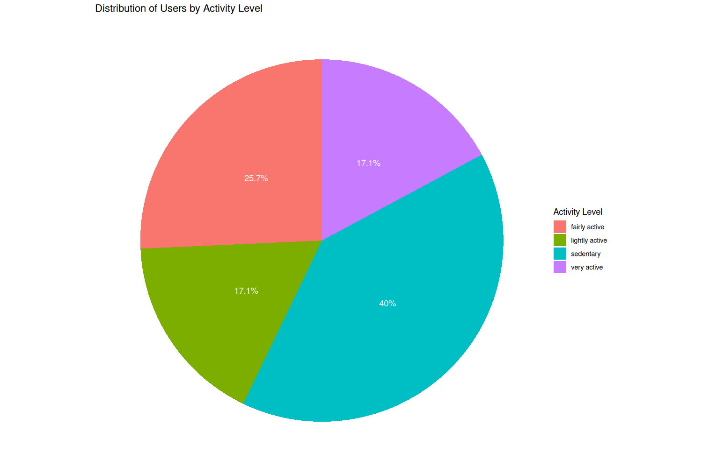

# Bellabeat Case Study: Fitness Data Analysis in R

## Project Overview
This project explores smart device fitness data to identify trends in users' activity and sleep patterns. The analysis is based on the Bellabeat case study and focuses on how consumer health data can support marketing decisions.

## Business Task
The goal is to understand how users interact with fitness tracking devices and identify insights that could help Bellabeat improve its products, user engagement, and marketing strategy.

## Tools Used
- R
- tidyverse
- dplyr
- ggplot2

## Analysis Process
1. Data preparation and cleaning
2. Exploration of daily activity and sleep data
3. Data aggregation and comparison of user activity levels
4. Data visualization
5. Interpretation of findings and business recommendations

## Areas Explored
- Daily steps and activity levels
- Calories and intensity of activity
- Sleep patterns
- Differences in users' activity levels

## Key Findings
The analysis includes an activity-level classification of users based on average daily steps. The results and visualizations are presented in the accompanying notebook.

## Business Recommendations
The findings can help inform strategies to encourage regular activity, support healthy routines, and improve engagement with Bellabeat products.

## Files
- `bellabeat-case-study (3).ipynb` — notebook containing the analysis, R code, explanatory text, and saved outputs.

## Notes
This is a portfolio case study focused on data analysis and business interpretation. The results should be interpreted in the context of the available dataset and its limitations.
## User Activity Distribution

